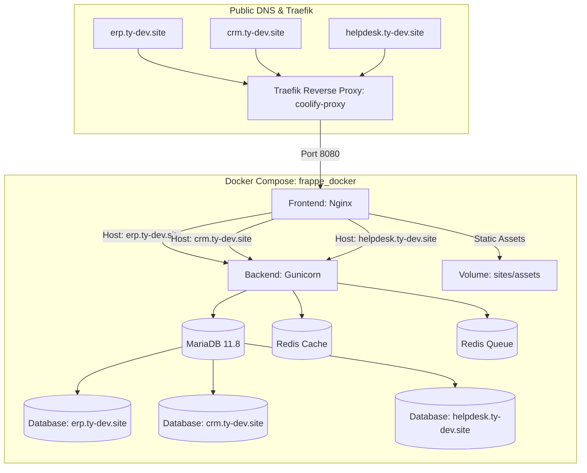

# Design Specification: Frappe Helpdesk Multi-Tenant Integration

- **Date:** 2026-11-16
- **Target Domain:** `https://helpdesk.ty-dev.site`
- **Application:** Coolify Docker Compose (`znll1xddverpkikx0bziglmh`)
- **App Repository:** `https://github.com/frappe/helpdesk.git` (branch: `version-16`)
- **Status:** Approved by User (/goal Approach 1)

---

## 1. Objective

Integrate **Frappe Helpdesk** as a 3rd distinct virtual site on the existing multi-tenant Frappe Docker Compose stack, operating alongside ERPNext and Frappe CRM:
- **`https://erp.ty-dev.site`** -> ERPNext (accounting, supply chain, inventory, operations).
- **`https://crm.ty-dev.site`** -> Frappe CRM (sales pipeline, deals, leads).
- **`https://helpdesk.ty-dev.site`** -> Frappe Helpdesk (customer support, ticket management, SLA tracking, knowledge base).

This maintains full multi-tenancy: each product has its own isolated database, isolated settings, and dedicated domain while sharing common MariaDB, Redis, Gunicorn, and Nginx containers to minimize server memory footprint (~2.5–2.8 GB total).

---

## 2. Architecture & Request Flow



---

## 3. Detailed Component Specification

### A. Docker Image (`Dockerfile`)
Add the `helpdesk` app (`version-16` branch), build its Vue SPA assets (`desk/`), and link static assets:
```dockerfile
RUN bench get-app --branch=main --resolve-deps crm https://github.com/frappe/crm \
    && (cd apps/crm/frontend && yarn install --network-concurrency 1 --network-timeout 300000 && yarn build) \
    && bench build --app crm \
    && ln -sf /home/frappe/frappe-bench/apps/crm/crm/public /home/frappe/frappe-bench/assets/crm \
    && bench get-app --branch=version-16 --resolve-deps helpdesk https://github.com/frappe/helpdesk \
    && (cd apps/helpdesk/desk && yarn install --network-concurrency 1 --network-timeout 300000 && yarn build) \
    && bench build --app helpdesk \
    && ln -sf /home/frappe/frappe-bench/apps/helpdesk/helpdesk/public /home/frappe/frappe-bench/assets/helpdesk \
    && find apps -mindepth 1 -path "*/.git" | xargs --no-run-if-empty rm -fr \
    && cp -r /home/frappe/frappe-bench/sites/assets/* /home/frappe/frappe-bench/assets/ 2>/dev/null || true \
    && rm -rf /home/frappe/frappe-bench/sites/assets
```

### B. Compose Configuration (`compose.coolify.yaml`)
1. **Frontend Traefik Routers:**
   Add Traefik routers for `helpdesk.ty-dev.site`:
   ```yaml
   - traefik.http.routers.frappe-helpdesk-http.rule=Host(`helpdesk.ty-dev.site`)
   - traefik.http.routers.frappe-helpdesk-http.entrypoints=http
   - traefik.http.routers.frappe-helpdesk-https.rule=Host(`helpdesk.ty-dev.site`)
   - traefik.http.routers.frappe-helpdesk-https.entrypoints=https
   - traefik.http.routers.frappe-helpdesk-https.tls=true
   - traefik.http.routers.frappe-helpdesk-https.tls.certresolver=letsencrypt
   - traefik.http.routers.frappe-helpdesk-https.service=frappe-frontend
   ```
2. **Site Provisioning (`create-site` service):**
   Add initialization logic for `helpdesk.ty-dev.site`:
   ```bash
   if [ -d "sites/helpdesk.ty-dev.site" ]; then
     echo "Site helpdesk.ty-dev.site exists, running migrations...";
     bench --site helpdesk.ty-dev.site migrate;
   else
     echo "Creating site helpdesk.ty-dev.site with Frappe Helpdesk...";
     bench new-site helpdesk.ty-dev.site \
       --mariadb-user-host-login-scope='%' \
       --admin-password=$${ADMIN_PASSWORD:-admin} \
       --db-root-username=root \
       --db-root-password=$${DB_PASSWORD:-admin} \
       --install-app helpdesk;
     bench --site helpdesk.ty-dev.site set-config home_page helpdesk;
     echo "helpdesk.ty-dev.site initialization completed!";
   fi;
   ```

### C. Coolify Domains
Update the Coolify application (`znll1xddverpkikx0bziglmh`) `docker_compose_domains` to:
```json
[
  {
    "name": "frontend",
    "domain": "https://erp.ty-dev.site,https://crm.ty-dev.site,https://helpdesk.ty-dev.site"
  }
]
```

---

## 4. Error Handling & Edge Cases

1. **IPv6 Registry Timeout in Docker Build:**
   As discovered during CRM build, Yarn v1 network concurrency can cause socket timeouts. Setting `--network-concurrency 1` and `--network-timeout 300000` prevents socket starvation and ensures reliable package fetching.
2. **Static Asset Resolution:**
   Nginx resolves static assets from `/home/frappe/frappe-bench/sites/assets/` which symlinks to `/home/frappe/frappe-bench/assets/`. The symlink `/home/frappe/frappe-bench/assets/helpdesk` points to `apps/helpdesk/helpdesk/public` where compiled SPA assets reside in `desk/`.
3. **Traefik Static File Conflicts:**
   Verify no legacy files in `/data/coolify/proxy/dynamic/` conflict with `helpdesk.ty-dev.site`.

---

## 5. Verification Plan

1. **DNS & SSL Resolution:**
   - Verify `helpdesk.ty-dev.site` resolves and Traefik obtains a valid SSL certificate.
2. **HTTP Endpoints:**
   - Unauthenticated `https://helpdesk.ty-dev.site` -> HTTP 200 OK (login page).
   - Authenticated `/helpdesk` -> HTTP 200 OK (Helpdesk SPA desk).
   - Static asset verification: `https://helpdesk.ty-dev.site/assets/helpdesk/desk/...` -> HTTP 200 OK.
3. **Non-Regression:**
   - Verify `https://erp.ty-dev.site` remains HTTP 200 OK.
   - Verify `https://crm.ty-dev.site` remains HTTP 200 OK.
   - Verify `https://app.ty-dev.site` remains HTTP 302 Found (GrowCRM).
