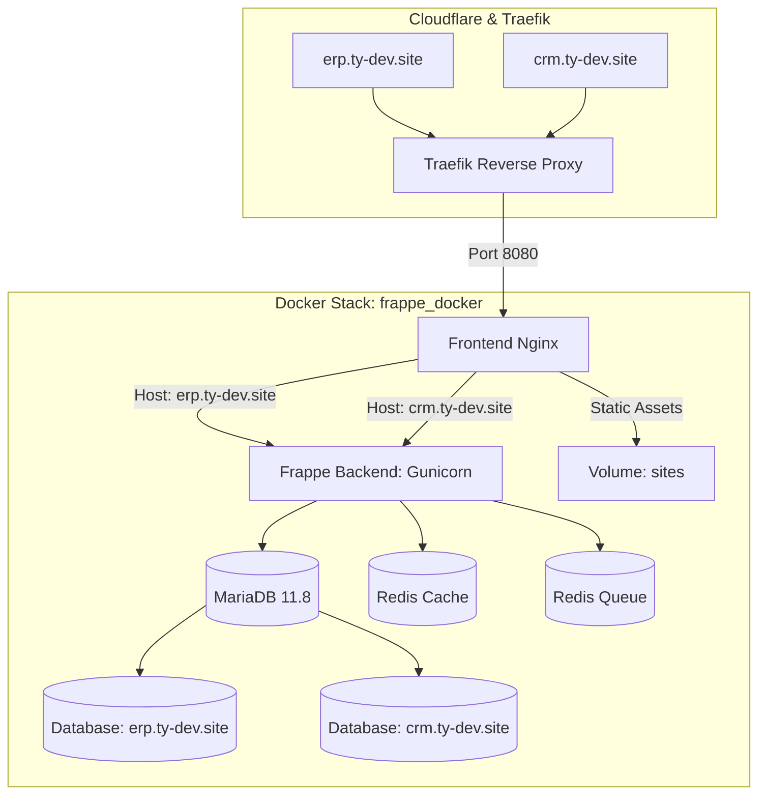

# Design Specification: Frappe Multi-Tenant Isolation (ERPNext & Frappe CRM)

- **Date:** 2026-11-16
- **Target Domains:** `https://erp.ty-dev.site` & `https://crm.ty-dev.site`
- **Application:** Coolify Docker Compose (`znll1xddverpkikx0bziglmh`)
- **Status:** Approved by User

---

## 1. Objective
Isolate **ERPNext** and **Frappe CRM** into two distinct virtual sites running on a single, shared multi-tenant Frappe Docker Compose stack:
- **`https://erp.ty-dev.site`** -> Dedicated to ERPNext (accounting, supply chain, inventory, operations).
- **`https://crm.ty-dev.site`** -> Dedicated to Frappe CRM (leads, deals, organizations, modern Vue SPA portal).

This provides full UI, permission, and database isolation between the sales and operations workflows while sharing a single MariaDB and Redis service to minimize server resource usage (~2–2.5 GB RAM total).

---

## 2. Architecture & Request Flow



---

## 3. Detailed Component Specification

### A. Traefik Routing (`compose.coolify.yaml`)
Update the `frontend` container labels in `compose.coolify.yaml` to register and route both domains with automated Let's Encrypt SSL:
```yaml
labels:
  - traefik.enable=true
  - traefik.docker.network=coolify
  - traefik.http.routers.frappe-erp-http.rule=Host(`erp.ty-dev.site`) || Host(`crm.ty-dev.site`)
  - traefik.http.routers.frappe-erp-http.entrypoints=http
  - traefik.http.routers.frappe-erp-https.rule=Host(`erp.ty-dev.site`) || Host(`crm.ty-dev.site`)
  - traefik.http.routers.frappe-erp-https.entrypoints=https
  - traefik.http.routers.frappe-erp-https.tls=true
  - traefik.http.routers.frappe-erp-https.tls.certresolver=letsencrypt
  - traefik.http.services.frappe-erp.loadbalancer.server.port=8080
```

### B. Frontend Nginx Dynamic Multitenancy
In `compose.coolify.yaml`, remove:
```yaml
FRAPPE_SITE_NAME_HEADER: ${FRAPPE_SITE_NAME_HEADER:-erp.ty-dev.site}
```
When `FRAPPE_SITE_NAME_HEADER` is not hardcoded, the official Frappe Nginx entrypoint passes the client's `$http_host` directly to Gunicorn. Frappe backend resolves `sites/$http_host/` automatically.

### C. Coolify Domains Configuration
Update the Coolify application (`znll1xddverpkikx0bziglmh`) `docker_compose_domains` to:
```json
[
  {"name": "frontend", "domain": "https://erp.ty-dev.site,https://crm.ty-dev.site"}
]
```

### D. Automated Site Provisioning (`create-site` service)
Modify `create-site` in `compose.coolify.yaml` to ensure both sites are provisioned and initialized:
1. **ERP Site (`erp.ty-dev.site`):**
   - If directory `sites/erp.ty-dev.site` exists: run `bench --site erp.ty-dev.site migrate`.
   - If not: create with `--install-app erpnext`.
2. **CRM Site (`crm.ty-dev.site`):**
   - If directory `sites/crm.ty-dev.site` exists: run `bench --site crm.ty-dev.site migrate`.
   - If not:
     ```bash
     bench new-site crm.ty-dev.site \
       --mariadb-user-host-login-scope='%' \
       --admin-password=${ADMIN_PASSWORD:-admin} \
       --db-root-username=root \
       --db-root-password=${DB_PASSWORD:-admin} \
       --install-app crm;
     bench --site crm.ty-dev.site set-config home_page crm;
     ```

---

## 4. Verification & Success Criteria

1. **ERPNext Verification:**
   - Request to `https://erp.ty-dev.site` returns HTTP 200 with ERPNext branding and login page.
   - `Administrator` can log in and view ERPNext workspaces.
2. **Frappe CRM Verification:**
   - Request to `https://crm.ty-dev.site` returns HTTP 200 with Frappe CRM frontend.
   - Root URL `/` or `/crm` loads the standalone CRM single-page application.
   - Database schemas are completely separated in MariaDB.
3. **SSL / DNS:**
   - Both domains have valid Let's Encrypt certificates served via Traefik.
